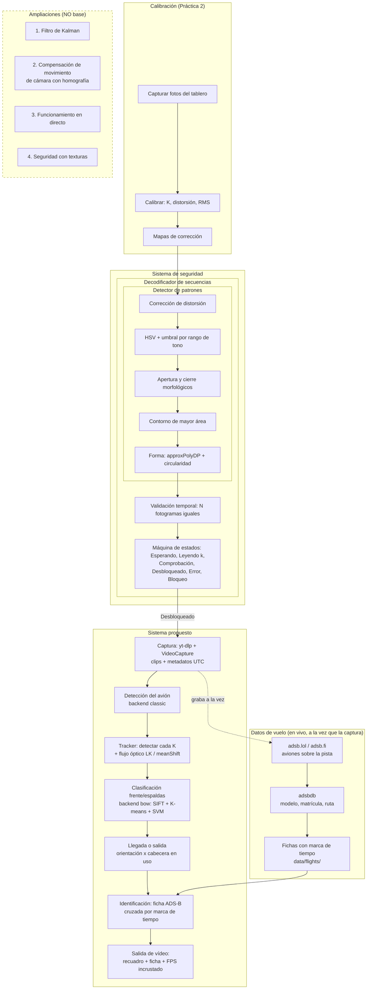

# LanzaroteTracker

Seguimiento e identificación de aviones en la cámara en directo del aeropuerto de
Lanzarote (ACE/GCRR).

Proyecto final de **Visión por Ordenador I** — 3.º Ingeniería Matemática e Inteligencia
Artificial, Universidad Pontificia Comillas (ICAI), curso 2026/27.

**Autores:** Javier Martínez Montelongo y Jaime Tuesta de Simón.

---

## Qué hace el sistema

El sistema trabaja sobre la cámara en directo de Flightradar24 del aeropuerto de
Lanzarote en YouTube, una cámara que gira y hace zoom para seguir a los aviones. Sobre
clips grabados de ese directo, el sistema:

1. detecta el avión y lo marca con un recuadro en cada fotograma;
2. lo sigue entre fotogramas pese al movimiento de la cámara;
3. clasifica si se ve de frente o de espaldas y, combinándolo con el sentido de uso de
   la pista, deduce si aterriza o despega;
4. identifica el vuelo cruzando el momento del clip con los datos ADS-B que se
   registraron mientras se grababa;
5. superpone una ficha con los datos **fijos** del avión: modelo, matrícula, origen y
   destino. Sin altura, sin velocidad y sin posición.

Antes de arrancar, el usuario se desbloquea mostrando a su webcam una secuencia de
**4 tarjetas**, cada una con una forma (círculo, triángulo, cuadrado, pentágono) y un
color (rojo, verde, azul, amarillo).

El sistema base trabaja sobre **clips grabados**, no en directo. La webcam sí funciona
en vivo en el bloque de seguridad, y es la cámara que se calibra.

---

## Diagrama de bloques



---

## Instalación

Con Conda, que es como se trabaja en la asignatura:

```bash
conda env create -f environment.yml
conda activate lanzarote-tracker
pip install -e .
```

Con pip y un entorno virtual (necesita Python 3.9):

```bash
python -m venv .venv
.venv\Scripts\activate        # en Windows
pip install -r requirements.txt
pip install -e .
```

`pip install -e .` instala el paquete en modo editable: los scripts importan
`lanzarote_tracker` sin trucos con `sys.path`.

Para comprobar que todo está en su sitio:

```bash
python scripts/check_environment.py
```

Imprime las versiones de Python, OpenCV y NumPy y qué trackers de OpenCV existen en esta
instalación.

### Credenciales

La fuente primaria (ADS-B) **no necesita credenciales**. Las de OpenSky, que es la
fuente secundaria, son OAuth2 (`client_id` y `client_secret`) y **nunca** van en el
código: se leen de variables de entorno.
Copia `.env.example` a `.env` y rellena los valores; `.env` está en `.gitignore`.

---

## Uso de los scripts

Todos los scripts aceptan `--help`.

| Script | Qué hace | Estado |
|---|---|---|
| `scripts/check_environment.py` | Versiones y trackers de OpenCV disponibles | Funciona |
| `scripts/camera_test.py` | Webcam con el FPS dibujado en cada fotograma | Funciona |
| `scripts/stream_test.py` | Abre el directo de YouTube con yt-dlp y OpenCV | Funciona |
| `scripts/capture_calibration_images.py` | Fotos del tablero con la webcam (ESPACIO) | Funciona |
| `scripts/generate_cards.py` | Genera las 16 tarjetas imprimibles | Funciona |
| `scripts/tune_hsv.py` | Trackbars para ajustar rangos HSV en vivo (H de 0 a 179) | Funciona |
| `scripts/track_flights.py` | Sigue los vuelos en vivo y registra sus fichas | Funciona |
| `scripts/calibrate_camera.py` | Calibra y guarda K, distorsión y RMS | Funciona |
| `scripts/main.py` | Flujo completo; sin opciones, webcam con FPS | Parcial |
| `scripts/run_security.py` | Solo el desbloqueo con la webcam | Pendiente |
| `scripts/record_clips.py` | Graba clips del directo con metadatos | Funciona |
| `scripts/extract_frames.py` | Extrae fotogramas de los clips | Funciona |
| `scripts/build_dataset.py` | División train/val/test por clips completos | Funciona |
| `scripts/train_classifier.py` | Entrena el clasificador de orientación | Pendiente |
| `scripts/run_tracker.py` | Detección + seguimiento + clasificación + ficha | Pendiente |

Los scripts marcados como pendientes **arrancan sin error** y fallan con un mensaje que
dice exactamente qué módulos faltan por implementar.

Orden de trabajo habitual:

```bash
python scripts/capture_calibration_images.py
python scripts/calibrate_camera.py
python scripts/generate_cards.py
python scripts/tune_hsv.py
python scripts/run_security.py
python scripts/record_clips.py --count 5 --seconds 60
python scripts/extract_frames.py
python scripts/build_dataset.py
python scripts/train_classifier.py
python scripts/run_tracker.py data/clips/<clip>.mp4
```

Tests:

```bash
python -m pytest -q
```

---

## Estructura del repositorio

```
.
├── CLAUDE.md                  contexto del proyecto para sesiones de Claude Code
├── environment.yml            entorno Conda
├── requirements.txt           equivalente pip
├── pyproject.toml             instalación editable del paquete
├── .env.example               nombres de las variables de entorno, sin valores
├── src/lanzarote_tracker/
│   ├── config.py              TODOS los parámetros, en dataclasses por módulo
│   ├── common/                io, FPS, logging, modo depuración
│   ├── calibration/           tablero, calibración pinhole, corrección de distorsión
│   ├── security/              segmentación, forma, lector temporal, máquina de estados
│   ├── capture/               URL del stream, clips, fotogramas, splits
│   ├── detection/             interfaz + classic + coco
│   ├── tracking/              interfaz + flujo óptico LK + meanShift + gestor
│   ├── classification/        interfaz + bow + cnn + llegada/salida
│   ├── identification/        ADS-B, adsbdb, OpenSky, emparejamiento, ficha
│   ├── visualization/         cajas, ficha superpuesta, FPS incrustado
│   └── extensions/            SOLO stubs de las ampliaciones
├── scripts/                   puntos de entrada ejecutables
├── notebooks/                 exploración y figuras del informe
├── calibration/images|results fotos del tablero y K, distorsión, RMS (se versiona)
├── assets/cards/              las 16 tarjetas imprimibles
├── assets/data/               base de aeropuertos (se versiona)
├── data/                      clips, fotogramas, anotaciones, splits (ignorado por git)
├── models/                    vocabularios BoW, SVM, pesos (ignorado por git)
├── results/                   salidas por módulo, incluida la secuencia de transformación
├── report/                    informe LaTeX, máximo 5 páginas
├── docs/                      propuesta, diagrama de bloques, notas de diseño
└── tests/                     pytest
```

---

## Estado de cada módulo

| Módulo | Qué incluye | Estado |
|---|---|---|
| `config` | Todos los parámetros en dataclasses | **Hecho** |
| `common` | io de imágenes y vídeo, FPS, logging, `DebugRecorder` | **Hecho** |
| `capture.stream_url` | URL del directo con yt-dlp | **Hecho** |
| `security.types` | Formas, colores, tarjeta, estados | **Hecho** |
| `calibration` | Tablero, calibración pinhole, corrección, guardado | **Hecho** |
| `security.segmentation` | HSV, morfología, contorno mayor | Pendiente |
| `security.shape_classifier` | `approxPolyDP` + circularidad | Pendiente |
| `security.card_reader` | Validación temporal de N fotogramas | Pendiente |
| `security.sequence_fsm` | Máquina de estados del desbloqueo | **Hecho** |
| `capture.recorder` | Clips con metadatos UTC, disparo por ADS-B | **Hecho** |
| `capture.frames` | Fotogramas y división por clips | **Hecho** |
| `detection.classic` | Segmentación del avión por color y morfología | Pendiente |
| `detection.coco` | Detector preentrenado | Opcional, pendiente |
| `tracking.optical_flow` | Lucas-Kanade sobre puntos Shi-Tomasi | Pendiente |
| `tracking.mean_shift` | meanShift sobre histograma de tono | Pendiente |
| `tracking.manager` | Detectar cada K + seguir | Pendiente |
| `classification.bow` | SIFT + K-means + SVM | Pendiente |
| `classification.cnn` | CNN propia | Opcional, pendiente |
| `classification.arrival_departure` | Llegada o salida | Pendiente |
| `identification` | ADS-B, adsbdb, OpenSky, emparejamiento, ficha | **Hecho** |
| `visualization` | Cajas, ficha, FPS incrustado | Pendiente |
| `extensions` | Las cuatro ampliaciones | Stubs, NO base |

---

## Calibración de la webcam

Hecha el 20/11/2026 con 19 fotos de un tablero de **8×6 esquinas internas** (cuadrado de
25 mm), a 1280×720. Los valores están en
[`calibration/results/`](calibration/results/), en `.npz` y en `.json`.

| | |
|---|---|
| Resolución | 1280 × 720 |
| fx, fy | 886.90, 886.71 px |
| cx, cy | 599.77, 373.24 px |
| Distorsión (k1, k2, p1, p2, k3) | 0.0416, −0.1831, 0.0004, −0.0024, 0.1734 |
| RMS de reproyección | 1.1380 px |
| Fotos válidas | 19 de 19 |

La calibración vale **solo para 1280×720**: es la resolución a la que hay que trabajar en
el bloque de seguridad, y `Undistorter` rechaza cualquier otra con un aviso explícito.

Dos consideraciones para el informe:

- El RMS por imagen se normaliza por la **raíz** del número de esquinas, no por el número
  de esquinas como en el tutorial de OpenCV, de modo que su media cuadrática coincide
  exactamente con el RMS que devuelve `cv2.calibrateCamera` y las dos cifras son
  comparables.
- El error no está repartido: `calib_016` y `calib_005` acumulan el 95,6 % del error
  total. Apartándolas el RMS bajaría a 0.2482 px y el punto principal se iría a
  (606.8, 360.1), casi el centro geométrico. Se ha decidido conservar las 19 fotos.

---

## Notas

**Deep learning: aprobado, pero secundario.** El profesor aprobó el uso de *deep
learning* el 20/11/2026, con la condición de que **esto sigue siendo un proyecto de
visión por ordenador tradicional**. Por eso los backends por defecto **no cambian**:
`classic` (detección) y `bow` (clasificación), que se apoyan en técnicas vistas en las
prácticas. Los backends `coco` y `cnn` son **alternativas opcionales** con las que
comparar en el informe, y no se empiezan hasta que la línea clásica esté terminada y
medida: sin `bow` entrenado no hay con qué comparar la CNN. Sus dependencias quedan
fuera del entorno base, en un extra que se instala aparte:

```bash
pip install -e ".[dl]"
```

**La identificación va en vivo, aunque el sistema trabaje sobre clips.** Los datos ADS-B
son efímeros: dicen qué aviones hay *ahora* sobre la pista. Por eso
`scripts/track_flights.py` tiene que ejecutarse **a la vez** que `scripts/record_clips.py`:
un clip grabado sin el seguimiento en marcha se queda sin ficha. Las fichas se guardan con
su marca de tiempo UNIX y después se cruzan con los clips.

**Dos fuentes para llegada o salida.** El sistema lo deduce **por visión**
(frente/espaldas + sentido de uso de la pista), que es lo que pide el enunciado y lo que
se evalúa. Los datos ADS-B lo dicen también, por el historial de alturas, pero esa vía no
se usa para rellenar la salida del clasificador: sirve como **etiqueta de referencia**
para entrenarlo y medirlo.

**Los clips no se publican.** Los clips grabados del directo y los fotogramas extraídos
quedan fuera del repositorio: `data/` está en `.gitignore` salvo su `README.md`. La
estructura esperada está documentada en [`data/README.md`](data/README.md).

**División del dataset.** Siempre por **clips completos**, nunca por fotogramas: dos
fotogramas consecutivos del mismo clip son casi idénticos, y repartirlos entre
particiones inflaría las métricas.

**Secuencia de transformación.** El informe exige una figura con todas las
transformaciones de la imagen. Cada pipeline acepta un `DebugRecorder`
(`common/debug.py`): al activar la depuración (`--debug` en los scripts) guarda sus
imágenes intermedias numeradas en `results/<módulo>/`, y además un mosaico.
